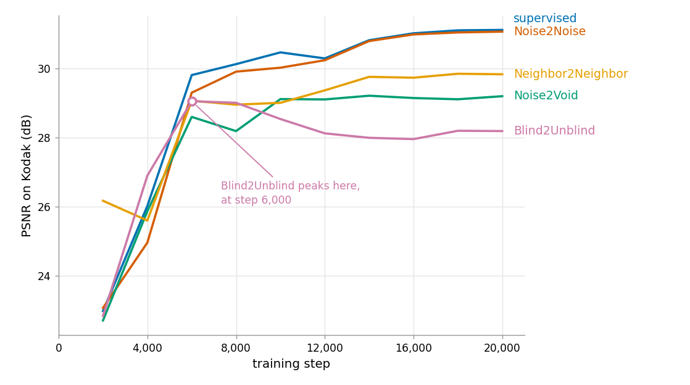
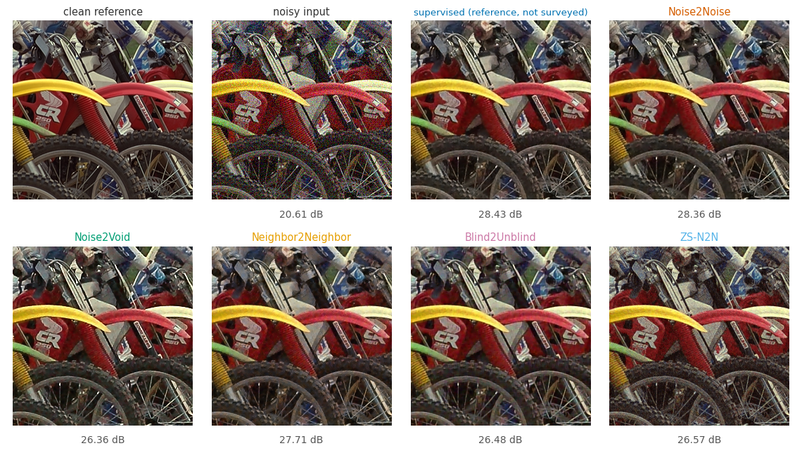

# Self-Supervised-Image-Denoising

[](#about-the-project)
[](#prerequisites)
[](#prerequisites)
[](#licence)

---

## 🧭 Table of Contents

<details open>
<summary>🧭 <b>Table of Contents (click to collapse)</b></summary>

- [📘 About the Project](#about-the-project)
- [🔧 Project Structure](#project-structure)
  - [⚙️ One Loop, Five Strategies](#one-loop-five-strategies)
  - [🗂️ Project Folder Structure](#project-folder-structure)
- [⚙️ Getting Started](#getting-started)
  - [✔️ Prerequisites](#prerequisites)
  - [📦 Installation and Setup](#installation-and-setup)
  - [▶️ Running the Experiments](#running-the-experiments)
  - [🎬 The Live Demonstration](#the-live-demonstration)
  - [📄 Output Files](#output-files)
- [🧪 The Experiments](#the-experiments)
  - [🅰️ Experiment A: is a noisy target really enough?](#experiment-a)
  - [🅱️ Experiment B: five methods, one protocol](#experiment-b)
  - [⏱️ The Step Cost Measurement](#the-step-cost-measurement)
  - [🎯 The Measurement Noise Floor](#the-measurement-noise-floor)
  - [🧊 Two Experiments Not Reported in the Paper](#two-experiments-not-reported-in-the-paper)
- [🖼️ Every Figure in the Paper](#every-figure-in-the-paper)
- [📸 Example Output](#example-output)
- [⚖️ Honest Limits](#honest-limits)
- [🧠 How It Works Internally](#how-it-works-internally)
- [📚 Credits and Third Party Code](#credits-and-third-party-code)
  - [🔍 Notes on the Released Code](#notes-on-the-released-code)
- [📖 Documentation](#documentation)
- [📜 Licence](#licence)
- [👩‍💻 Author](#author)

</details>

---

<a id="about-the-project"></a>
## 📘 About the Project

This project was developed as part of the **"20375 Seminar in a Special Topic in Computer Science" (2026C)** course at the **Open University of Israel**.

It is the companion code for a seminar paper on **self-supervised image denoising**, the family of methods that train a denoising network without ever showing it a clean image. The paper surveys five publications, and this repository implements all five under one shared network, one shared training loop and one shared evaluation protocol, so that the differences between them can be measured rather than assumed.

| reference | paper | venue |
|---|---|---|
| [4] | Noise2Noise | ICML 2018 |
| [3] | Noise2Void | CVPR 2019 |
| [2] | Neighbor2Neighbor | CVPR 2021 |
| [7] | Blind2Unblind | CVPR 2022 |
| [5] | Zero-Shot Noise2Noise (ZS-N2N) | CVPR 2023 |

Everything in this repository runs on an ordinary laptop CPU. There is no GPU, no cloud service and no account to create.

> 💡 The seminar paper itself is written in Hebrew and is not published here. This repository is the code appendix to it.

---

<a id="project-structure"></a>
## 🔧 Project Structure

<a id="one-loop-five-strategies"></a>
### ⚙️ One Loop, Five Strategies

The central claim of the survey is that the five methods differ in **one thing only**: what is fed to the network, and what the loss measures the output against. The architecture, the optimiser and the training schedule are identical throughout.

The code is laid out so that this claim can be checked instead of taken on trust. There is one network, one training loop, and five short modules under `src/strategies/`. The loop itself never names a method:

```python
loss = strategy.step(net, clean, noise, gen, progress)
```

Passing a different `--method` swaps that one object and nothing else. Whoever wants to see what separates Blind2Unblind from Noise2Void can read the difference between two files of roughly 60 and 90 lines.

The project follows the same principles the paper is written by: **clarity**, **reproducibility**, and **no claim without a measurement behind it**. Every run uses a fixed random seed, so every number and every figure in the paper can be reproduced exactly.

<a id="project-folder-structure"></a>
### 🗂️ Project Folder Structure

<details>
<summary>🗂️ <b>Click to view the full folder tree</b></summary>

```text
Self-Supervised-Image-Denoising/
├── src/                      # the shared machinery
│   ├── unet_n2nbr.py         # the network every method trains
│   ├── common.py             # image IO, padded inference, neighbour sub-sampler
│   ├── data.py               # random crops and the noise applied during training
│   ├── noise.py              # Gaussian and Poisson noise models
│   ├── metrics.py            # PSNR and SSIM, computed as the papers compute them
│   ├── train.py              # one training loop for every method
│   ├── zs_n2n.py             # the per image method, which does not fit that loop
│   ├── hebrew.py             # right to left labels, with or without Raqm
│   └── strategies/           # one short file per method, and nothing else differs
│       ├── base.py
│       ├── supervised.py
│       ├── noise2noise.py
│       ├── noise2void.py
│       ├── neighbor2neighbor.py
│       └── blind2unblind.py
│
├── experiments/              # every measurement reported in the paper
│   ├── exp_a_noise2noise_theorem.py
│   ├── exp_d_compare_methods.py
│   ├── step_cost.py
│   ├── eval_noise_spread.py
│   ├── exp_b_zs_n2n.py
│   └── exp_c_demosaic_correlation.py
│
├── figures/                  # one module per figure in the paper
│   ├── style.py              # Hebrew right to left titles, panel layout
│   ├── sources.py            # the two source images and the noise
│   ├── fig_1_1.py ... fig_7_1.py
│   └── make_all.py           # rebuilds all twelve in one command
│
├── demo/
│   └── live_demo.py          # the three part demonstration for the talk
│
├── scripts/
│   ├── get_data.py           # fetches images and published checkpoints
│   └── make_readme_figures.py
│
├── figures_out/              # the twelve figures, as figures/ writes them
│
├── docs/                     # the figures shown in this file
│   ├── training_curves.png
│   └── before_after.png
│
├── licenses/                 # licences of the third party code reused here
│   ├── Neighbor2Neighbor-LICENSE
│   └── Noise2Void-LICENSE
│
├── results/                  # the measurements the paper quotes
├── weights/                  # the five trained checkpoints
│
├── run_all.bat               # trains all five methods in sequence
├── requirements.txt
├── LICENSE
└── README.md
```

</details>

---

<a id="getting-started"></a>
## ⚙️ Getting Started

<a id="prerequisites"></a>
### ✔️ Prerequisites

Before running the project, make sure the following are available:

- 🐍 **Python 3.12** (developed and tested on `Python 3.12.9`)
- 🔥 **PyTorch 2.0 or newer**, installed by `requirements.txt`
- 💻 **A CPU is enough.** The whole project was developed and run on an ordinary personal computer with no graphics card. Two threads were used throughout, and that is what the reported timings refer to.
- 🌐 **git and a network connection**, for the one time data download
- 🪟 **Windows** for `run_all.bat`. All the Python code is platform independent; only that one batch file is not.

> 💡 The five trained checkpoints are committed to the repository, so the demonstration and the comparison figures run immediately without training anything.

> 🔤 Every figure and every demonstration window carries Hebrew labels. PIL orders Hebrew correctly through the Raqm layout engine, which not every Pillow build ships with, so `src/hebrew.py` does the ordering itself where Raqm is missing. Either way the labels come out right, and nothing extra has to be installed.

---

<a id="installation-and-setup"></a>
### 📦 Installation and Setup

1. **Clone the repository**

   ```bash
   git clone https://github.com/Rut-Hagai/Self-Supervised-Image-Denoising.git
   ```

2. **Change to the project directory**

   ```bash
   cd Self-Supervised-Image-Denoising
   ```

3. **Install the dependencies**

   ```bash
   pip install -r requirements.txt
   ```

4. **Fetch the images and the published checkpoints**

   ```bash
   python scripts/get_data.py
   ```

   This step runs once. It downloads the Kodak test set, the BSDS500 training images and the checkpoint released by the authors of Neighbor2Neighbor. None of them are committed here: they are not mine to redistribute, and a repository should not carry 37 MB of other people's data.

---

<a id="running-the-experiments"></a>
### ▶️ Running the Experiments

Every experiment is a module and is run with `python -m`:

```bash
python -m experiments.exp_a_noise2noise_theorem      # tens of minutes
python -m experiments.step_cost --steps 200          # minutes
python -m experiments.eval_noise_spread              # minutes
python -m experiments.exp_c_demosaic_correlation     # seconds
python -m experiments.exp_b_zs_n2n --images 5        # about 5 minutes per image
```

The five method comparison is a training run and therefore the long one:

```bash
run_all.bat                                          # the five trainings, hours
python -m experiments.exp_d_compare_methods          # reads the five logs
```

`run_all.bat` trains supervised, Noise2Noise, Noise2Void, Neighbor2Neighbor and Blind2Unblind for 20,000 steps each with everything else held fixed. `exp_d_compare_methods.py` then reads the five logs and produces the comparison table and the figure. **Running it is optional**: the logs it reads are committed under `results/`, so the table and the figure can be reproduced without retraining.

A single method can also be trained on its own:

```bash
python -m src.train --method noise2void --steps 20000
```

The twelve figures of the paper are rebuilt the same way, and that has a section of its own further down:

```bash
python -m figures.make_all                           # under a minute
```

> 🗒️ Every script reads its inputs from files and writes its outputs to files. Nothing asks for interactive input while it runs. All of them take `--threads N`, which is worth raising above the default on a machine with more than two cores.

---

<a id="the-live-demonstration"></a>
### 🎬 The Live Demonstration

`demo/live_demo.py` is the demonstration prepared for the seminar talk. It has three parts, meant to be shown in that order. Each one opens a window of real images and also writes that window to `results/`, so the pictures exist even if something misbehaves on the day.

```bash
python -m demo.live_demo --part 1                      # seconds
python -m demo.live_demo --part 2                      # seconds
python -m demo.live_demo --part 3 --iterations 1000    # minutes
```

#### 🅐 Part 1: the model its authors published

Loads the checkpoint released by the authors of Neighbor2Neighbor and runs it on a test image. **This is not my training.** It is the model behind a number printed at CVPR, reproduced in front of the audience.

**On screen:** three panels, the clean image, the noisy one and the output, with the PSNR under each. **In the terminal:** the parameter count, the time the denoising took on this machine, and the PSNR before and after. **Written to:** `results/demo_part1.png`.

#### 🅑 Part 2: five runs, one protocol

The same noisy image through every network trained here: the supervised reference and the four dataset based methods. ZS-N2N is absent because it has no saved network; it is part 3.

**On screen:** seven panels with the PSNR under each, headed "the same network, the same data and the same training schedule, only the training pair and the loss differ". **In the terminal:** PSNR and SSIM per method. **Written to:** `results/demo_part2.png`.

#### 🅒 Part 3: ZS-N2N trained in front of the audience

A network of 22,275 parameters is initialised and trained on the single image on screen. Nothing is prepared in advance, and ZS-N2N is the only one of the five that can honestly be trained live.

**On screen:** a window that redraws every 100 steps, the noisy image on one side and the network's current output on the other, with the step and the PSNR below, so the cleaning is watched as it happens. A summary window follows at the end. **In the terminal:** the step, the elapsed time and the PSNR every 200 steps. **Written to:** `results/demo_part3.png`.

> ⏱️ Time this part before the talk. 2,000 iterations took 508 seconds on two CPU threads here. Set `--iterations` to what the available minutes allow; 1,000 already gives a good result.

#### 🖼️ Running it on your own photograph

Every part accepts an image instead of the test set:

```bash
python -m demo.live_demo --part 2 --image-path photo.jpg --already-noisy
python -m demo.live_demo --part 3 --image-path photo.jpg --already-noisy --iterations 1000
```

`--already-noisy` says the file is a real noisy photograph, so nothing is added to it and no PSNR is reported, because no clean version of it exists. Leave the flag out and the file is treated as clean, noise is added to it, and the numbers come back.

A photograph taken in low light makes the strongest demonstration, and it is worth trying once beforehand: real sensor noise is not Gaussian while these networks were trained on Gaussian noise, so the result may be less impressive than on a test image. That is a finding in itself, and it is what section 9.5 of the paper is about.

#### ⚙️ Flags

| flag | what it does |
|---|---|
| `--part 1`, `2`, `3` | run one part. Omit it to run all three in order |
| `--image 7` | a different one of the 24 Kodak test images (default 4) |
| `--image-path FILE` | any image file instead of the test set |
| `--already-noisy` | the file is a real noisy photograph: no noise added, no PSNR |
| `--crop 128` | the square crop taken from the centre. `0` for the whole image (default 256) |
| `--iterations 1000` | how long ZS-N2N trains in part 3 (default 2000) |
| `--threads 4` | CPU threads. Worth raising if the machine has more than two |
| `--no-window` | no windows, numbers in the terminal only |
| `--seed 0` | the noise draw, so a run can be repeated exactly |

---

<a id="output-files"></a>
### 📄 Output Files

| Location | What is written there |
|---|---|
| `weights/<method>_gauss25.pth` | the trained network of that method |
| `results/<method>_gauss25.json` | its PSNR curve along training |
| `results/exp_a.json` | the two arms of experiment A and the gap between them |
| `results/exp_d.json` | the five method comparison, table and curves |
| `results/step_cost.json` | seconds per training step, per method |
| `results/eval_noise_spread.json` | how much the reported PSNR depends on the noise draw |
| `results/exp_c.png`, `exp_d.png` | the figures those two experiments draw |
| `results/demo_part1.png` to `demo_part3.png` | whatever the demonstration last put on screen |
| `figures_out/fig_1_1.png` to `fig_7_1.png` | the twelve figures of the paper |

The result files the paper quotes are committed; the downloaded images and the published checkpoints are not.

---

<a id="the-experiments"></a>
## 🧪 The Experiments

The paper numbers its two experiments with Hebrew letters. The file names were fixed before that order was, so this is the mapping:

| in the paper | section | file |
|---|---|---|
| experiment א | 10.2 | `experiments/exp_a_noise2noise_theorem.py` |
| experiment ב | 10.3 | `run_all.bat`, then `experiments/exp_d_compare_methods.py` |
| the step cost measurement | 10.3 | `experiments/step_cost.py` |
| the measurement noise floor | 10.4 | `experiments/eval_noise_spread.py` |
| not reported in the paper | | `experiments/exp_b_zs_n2n.py` |
| not reported in the paper | | `experiments/exp_c_demosaic_correlation.py` |

<a id="experiment-a"></a>
### 🅰️ Experiment A: is a noisy target really enough?

`experiments/exp_a_noise2noise_theorem.py`

The claim the whole field rests on is that a network trained against a **noisy** target converges to the same place as one trained against a **clean** target. This experiment tests exactly that and nothing else.

Two training runs start from the **same** initial weights, on the same crops in the same order, with the same noise draws, the same optimiser and the same seed. The only difference between them is the target: one is given the clean image, the other a second independent noisy image. If the Noise2Noise argument holds, the two runs end in the same place.

| arm | PSNR on Kodak after 800 steps |
|---|---|
| clean target | **22.8510 dB** |
| noisy target | **22.8497 dB** |
| **difference** | **0.0013 dB** |

This is the one claim in the survey that can be tested honestly at this scale, because it is a statement about two runs agreeing with each other and not about absolute quality.

<a id="experiment-b"></a>
### 🅱️ Experiment B: five methods, one protocol

`run_all.bat`, then `experiments/exp_d_compare_methods.py`

Each published paper reports its method under its own training conditions, on its own hardware, against its own baselines. Those numbers cannot be compared with each other. This experiment trains all five under one identical protocol: the same network, the same 200 training images, the same 20,000 steps, the same noise and the same seed.

| method | final PSNR | gap to supervised | best PSNR | at step | gap reported in the papers |
|---|---|---|---|---|---|
| supervised | 31.11 | | 31.11 | 20,000 | |
| Noise2Noise | 31.07 | 0.05 | 31.07 | 20,000 | 0.02 |
| Neighbor2Neighbor | 29.83 | 1.28 | 29.85 | 18,000 | 0.35 |
| Noise2Void | 29.19 | 1.92 | 29.21 | 14,000 | 2.11 |
| Blind2Unblind | 28.19 | 2.93 | 29.05 | **6,000** | 0.16 |

Two of the five results reproduce the published picture closely: the Noise2Noise gap of 0.05 dB against a reported 0.02 dB, and the Noise2Void gap of 1.92 dB against a reported 2.11 dB.

**Blind2Unblind did not.** Its PSNR peaks at step 6,000 and falls by 1.10 dB by step 16,000. Three points about it are worth stating precisely:

- It is **not** the only run whose best is not at the last step. Noise2Void and Neighbor2Neighbor also peak earlier, but by 0.015 dB. What sets Blind2Unblind apart is the size of the drop, 0.864 dB.
- The **lambda schedule is not the cause**. In the code the authors published, lambda stays fixed at 2 for the first four fifths of training and only begins to rise at step 16,000. The whole of the decline happened before that, and after step 16,000 the PSNR actually recovered slightly.
- The implementation here was checked against the authors' released code at that point and matches it, so this is not an implementation error. **What does cause the decline was not isolated**, and the paper says so rather than guessing.

<a id="the-step-cost-measurement"></a>
### ⏱️ The Step Cost Measurement

`experiments/step_cost.py`

Four of the five papers report almost nothing about the cost of training. This measurement supplies it for the five methods under identical conditions: 200 consecutive steps, no evaluation in between, two CPU threads.

| method | seconds per step | relative to supervised |
|---|---|---|
| supervised | 0.160 | |
| Noise2Noise | 0.157 | 0.98 |
| Noise2Void | 0.160 | 1.00 |
| Neighbor2Neighbor | 0.108 | **0.67** |
| Blind2Unblind | 0.590 | **3.68** |

Blind2Unblind passes the image through the network five times per step rather than once. The ratio is nevertheless below five, because the four masked versions are processed as a single batch and the fifth pass runs under a stop gradient and therefore has no backward pass. Neighbor2Neighbor is the cheapest of all, because it trains on sub-images at half resolution in each axis, that is on a quarter of the pixels.

The timings are measured separately, in their own script, because the wall clock figures inside the training logs include time the machine spent suspended and are not usable.

<a id="the-measurement-noise-floor"></a>
### 🎯 The Measurement Noise Floor

`experiments/eval_noise_spread.py`

Computing PSNR means adding noise to a clean test image, and that noise is drawn at random. A different draw gives a slightly different number. Every figure in this project uses one draw per test image with a fixed seed, so this script asks what that choice costs: it re-evaluates the **same** trained weights under five different noise draws and reports the spread.

| method | spread over five noise draws | standard deviation |
|---|---|---|
| supervised | 0.0075 dB | 0.0036 |
| Noise2Void | 0.0050 dB | 0.0019 |

The answer bounds every small difference quoted anywhere in the project: a gap below 0.01 dB is not evidence of anything.

<a id="two-experiments-not-reported-in-the-paper"></a>
### 🧊 Two Experiments Not Reported in the Paper

Both were written, run, and their results are sound. They were left out of the paper for length, and the questions they ask appear in its closing chapter as directions for further work instead. The code is kept here because the measurements stand on their own.

<details>
<summary>🧊 <b>Click to view both</b></summary>

#### ZS-N2N against classical filters

`experiments/exp_b_zs_n2n.py`

A network of 22,275 parameters is trained from scratch on one noisy image, used, and thrown away. With no dataset behind it, the fair question is not whether it beats a dataset trained network but whether it beats a well tuned classical filter. Five Kodak images, 256 by 256 centre crops, Gaussian sigma 25:

| method | PSNR | SSIM | seconds per image |
|---|---|---|---|
| the noisy image | 20.44 | 0.37 | |
| Gaussian blur | 26.68 | 0.66 | under 1 |
| non-local means | 27.16 | 0.70 | under 1 |
| total variation | 27.90 | 0.74 | under 1 |
| ZS-N2N | 29.45 | 0.80 | 317 |
| **BM3D** | **31.53** | **0.87** | **7** |

ZS-N2N clears the three simple filters. BM3D then clears ZS-N2N by 2.08 dB in a forty fifth of the time. BM3D is given the true noise level and ZS-N2N is given nothing but the image, and the BM3D figure here is the colour variant, which filters the three channels jointly. The ZS-N2N paper reports BM3D at 29.02 dB on Kodak at this noise level, 2.51 dB below what is measured here; which BM3D variant it used could not be determined from the paper.

#### Where the independence assumption breaks

`experiments/exp_c_demosaic_correlation.py`

Four of the five methods assume that the noise in one pixel is independent of the noise in its neighbours. A camera sensor satisfies that assumption. A finished photograph does not, because filling in the two missing colour channels mixes neighbouring values, and whatever that does to the signal it does to the noise as well.

The experiment builds a raw RGGB sensor reading, adds independent noise to each photosite, demosaics it, and measures what is left:

| correlation measured between | before demosaicing | after |
|---|---|---|
| horizontal neighbours | 0.00 | **0.40** |
| vertical neighbours | 0.00 | **0.40** |
| the pair Neighbor2Neighbor trains on | 0.00 | **0.50** |
| the pair ZS-N2N trains on | 0.00 | **0.82** |

The result is a lower bound. Only one stage of the camera pipeline is simulated, in its simplest variant, and the noise added is uniform Gaussian while a real sensor's depends on light intensity. Both simplifications push the true figure up rather than down.

</details>

---

<a id="every-figure-in-the-paper"></a>
## 🖼️ Every Figure in the Paper

No figure in the paper is taken from a publication. All thirteen were produced for it, and all thirteen are reproducible from this repository:

```bash
python -m figures.make_all              # the twelve illustrations
python -m figures.make_all 2.3 6.2      # or just the ones named
python -m experiments.exp_d_compare_methods   # figure 10.1, which is a result
```

| figures | module |
|---|---|
| 1.1 | `figures/fig_1_1.py` |
| 2.1 to 2.4 | `figures/fig_2_1.py` to `fig_2_4.py` |
| 3.1 to 3.3 | `figures/fig_3_1.py` to `fig_3_3.py` |
| 5.1, 6.1, 6.2, 7.1 | `figures/fig_5_1.py`, `fig_6_1.py`, `fig_6_2.py`, `fig_7_1.py` |
| 10.1 | `experiments/exp_d_compare_methods.py` |

Figure 10.1 is in the second group on purpose. It is not an illustration of an idea but the result of the five method comparison, so it is drawn by the experiment that measured it, from the training logs in `results/`.

Two things make the output reproducible to the pixel. The two source images, the grey `camera` and the colour `astronaut`, ship with scikit-image and are therefore identical on every machine, and every noise draw comes from a NumPy generator with a fixed seed. Titles are Hebrew, because the paper is, and they are drawn with PIL rather than matplotlib, which cannot shape right to left text.

<a id="example-output"></a>
## 📸 Example Output

<details open>
<summary>📸 <b>Click to collapse</b></summary>

**The five methods along training.** Every curve is one run of experiment B, measured on the Kodak test set every 2,000 steps.

<p align="center">
  
</p>

**The same noisy crop through all five methods.** One 256 by 256 centre crop from the Kodak set with Gaussian noise at sigma 25, and what each method returns for it.

<p align="center">
  
</p>

Two panels need a word of explanation:

- **supervised** is not one of the five surveyed methods. It is the reference run, a network of exactly the same shape trained against **clean** targets, which is the thing all five are trying to do without. It is in the figure as the ceiling: it shows how much of the quality survives when the clean image is taken away.
- **ZS-N2N** is the only method here that has no saved network behind it. It trains a network of 22,275 parameters on the single image it is given and then throws it away, so the panel shown was trained on that one crop while the figure was being built. The other four load the checkpoints under `weights/`, which is why building this figure takes minutes rather than seconds.

Both figures are produced by `python -m scripts.make_readme_figures`.

> 🗒️ ZS-N2N sees only this one image, while the other four were trained on 200. Its number here is therefore not comparable with theirs, and that is the point of the method rather than a flaw in it.

</details>

---

<a id="honest-limits"></a>
## ⚖️ Honest Limits

Training here is nothing like training in the papers. Neighbor2Neighbor trains for 100 epochs over 44,328 ImageNet crops on a graphics processor. This project trains on 200 BSDS500 images on two CPU threads, which is roughly one fifty fifth of the images and a far shorter schedule.

The consequences are stated rather than hidden:

- The absolute PSNR values produced here are **well below the published ones** and are **not** offered as reproductions of them.
- What they are good for is **comparison**. Every method is trained under one identical protocol, so the differences between them carry meaning even though the levels do not.
- Every measurement uses **one noise draw** per test image. The measurement noise floor above says what that is worth: under 0.01 dB.
- Where a published number is quoted anywhere in this project, it is quoted from the paper that published it.

One published number is also verified directly. Loading the checkpoint released by the Neighbor2Neighbor authors and evaluating it on the Kodak set with their own protocol gives **32.105 dB** against the **32.08 dB** printed in their paper, a difference of 0.03 dB explained by averaging one noise draw per image here instead of ten there.

---

<a id="how-it-works-internally"></a>
## 🧠 How It Works Internally

Each training step is assembled from the same parts, and only the strategy object changes:

- **The network.** One U-Net, shared by every method, loaded from `src/unet_n2nbr.py`.
- **The data pipeline.** `src/data.py` draws a random crop, and `src/noise.py` applies the noise model to it. The clean crop and the noise generator are handed to the strategy, which decides what to do with them.
- **The strategy.** One object per method, under `src/strategies/`. It builds the input and the target from the clean crop and the noise, runs the network, and returns a single loss value. This is the only place where the five methods differ.
- **The loop.** `src/train.py` calls the strategy, backpropagates the loss it returns, steps the optimiser, and evaluates on the test set at fixed intervals. It does not know which method it is training.
- **The exception.** ZS-N2N trains a fresh network on the single image it is denoising, so it has no dataset and no shared loop. It lives on its own in `src/zs_n2n.py`.

Evaluation is shared as well. PSNR and SSIM are computed in `src/metrics.py` on 8 bit values, which is how the surveyed papers compute them, and inference pads the image so that the network sees a size it can handle and the padding is removed afterwards.

---

<a id="credits-and-third-party-code"></a>
## 📚 Credits and Third Party Code

This project reuses code where the licence allows it and reimplements it where it does not. Every file that contains third party code says so at the top.

| source | licence | what is used here |
|---|---|---|
| [TaoHuang2018/Neighbor2Neighbor](https://github.com/TaoHuang2018/Neighbor2Neighbor) | BSD 3-Clause | the U-Net (`src/unet_n2nbr.py`) and the neighbour sub-sampler (`src/common.py`), reused so that the sampling is provably the one behind the published numbers. Licence in `licenses/`. |
| [juglab/n2v](https://github.com/juglab/n2v) | BSD 3-Clause | reference for the blind spot masking. The implementation here is written against it rather than copied. Licence in `licenses/`. |
| [zejinwang/Blind2Unblind](https://github.com/zejinwang/Blind2Unblind) | **no licence file** | **no code is reused.** The repository was read only in order to check behaviour. `src/strategies/blind2unblind.py` is written from the equations in the paper. |
| [NVlabs/noise2noise](https://github.com/NVlabs/noise2noise) | NVIDIA research licence | not used. It is TensorFlow 1 from 2018, and the method is reimplemented from the paper in four lines. |
| ZS-N2N | code printed inside the paper | `src/zs_n2n.py` follows the implementation the authors print in arXiv:2303.11253. |
| [BIDS/BSDS500](https://github.com/BIDS/BSDS500) | | the 200 training images, fetched rather than committed. |

<a id="notes-on-the-released-code"></a>
### 🔍 Notes on the Released Code

Three things turned up while checking this project against the authors' own repositories. None of them changes what the papers say. They are recorded because anyone who reads both the paper and the code will meet them.

<details>
<summary>🔍 <b>Click to view all three</b></summary>

1. **Blind2Unblind: the cell size.** The paper divides the image into cells of size s by s and states that s is set to 2, which gives four masked versions. The released code defaults to a width of 4, which gives sixteen. This project follows the paper.

2. **Blind2Unblind: the lambda schedule.** The paper gives a starting value of 2 and a final value of 20, but no schedule between them. The released code has one: lambda stays at 2 for the first 80 percent of training and then rises linearly to 20. This project follows the code, since the paper leaves the question open.

3. **Neighbor2Neighbor: a PyTorch incompatibility.** `arch_unet.py` passes `False` as the sixth positional argument of `nn.ConvTranspose2d`, which is `output_padding` and not `bias`. Older PyTorch coerced it to 0; PyTorch 2 raises a `TypeError`, so the released checkpoints cannot be loaded without a fix. The one character patch is marked in `src/unet_n2nbr.py`. The released checkpoints do contain deconvolution bias tensors, which confirms what was intended.

</details>

---

<a id="documentation"></a>
## 📖 Documentation

Every module opens with a docstring saying what it is for and how it is run, and every function that is not self evident carries a header comment explaining its purpose and its arguments. Comments inside the code explain the reasoning behind a choice rather than restating what the line does.

Each strategy file opens with the equation it implements, written as the paper writes it, so that a reader can hold the paper beside the file and follow the correspondence line by line.

---

<a id="licence"></a>
## 📜 Licence

The code written for this project is released under the **MIT licence**, see `LICENSE`. Third party components keep their own licences, listed above and reproduced in `licenses/`.

---

<a id="author"></a>
## 👩‍💻 Author

Developed by **Ruth Hagai**
as part of the **Open University of Israel course 20375, Seminar in a Special Topic in Computer Science (2026C)**.

[GitHub Profile →](https://github.com/Rut-Hagai)

---

⭐ If you found this project interesting, consider giving it a star on GitHub.
